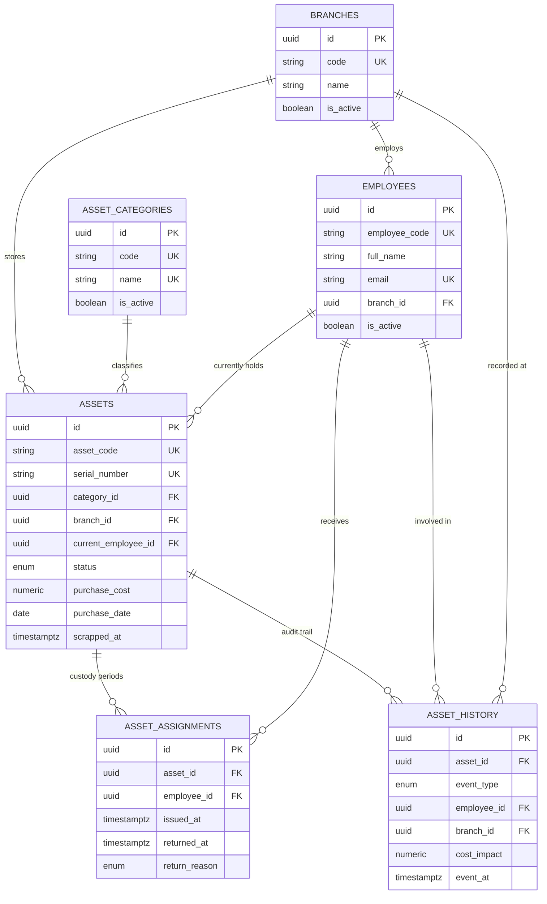

# Asset Management System — Production Architecture, Schema & Sequelize Blueprint

**Tech Stack:** Node.js (Express) · PostgreSQL 15+ · Sequelize v6 ORM

---

## 1. Requirement Review & Architectural Decisions

Before jumping into the schema, here is a review of gaps and concurrency/data-integrity risks identified in the initial requirements and how this design solves them:

| Area | Gap / Risk Identified | Production Solution in This Design |
| :--- | :--- | :--- |
| **Branch Master Missing** | Requirement 4 ("Stock View") needs totals by branch, but no Branch master was listed. Free-text branch strings cause reporting drift (`"NYC"` vs `"New York"`). | Added a `branches` master table referenced by both `employees` and `assets`. |
| **Dual Asset Identification** | Requirement 2 asks for identification by *both* serial number and unique ID. UUIDs are great for PKs/APIs, but humans and barcode stickers need short codes. | `assets` has `id` (`UUID` PK), `asset_code` (human-readable unique tag like `AST-000142`), and `serial_number` (`UNIQUE`). |
| **Repair vs. In-Stock State** | Requirement 6 captures return reason `repair`. Returning a broken laptop straight to `in_stock` risks issuing faulty hardware. | `assets.status` uses `ENUM('in_stock', 'issued', 'under_repair', 'scrapped')`. Returns for `repair`/`damaged` transition to `under_repair`; others go to `in_stock`. |
| **Double-Issue Race Conditions** | Two admins issuing the same laptop concurrently could overwrite ownership or create duplicate active assignments. | `issueAsset` and `returnAsset` run inside `SERIALIZABLE`/`READ COMMITTED` transactions with PostgreSQL row-level locking (`SELECT ... FOR UPDATE`), plus a DB-level `CHECK` constraint and partial unique index (`WHERE returned_at IS NULL`). |
| **Scrapped Asset Isolation** | Requirement 7 requires scrapped assets to be hidden everywhere *except* reports (and Requirement 8 Asset History). Manual `WHERE` clauses are easy to forget. | `Asset` model uses a Sequelize `defaultScope` excluding `status = 'scrapped'`, plus explicit `.scope('withScrapped')` and `.scope('onlyScrapped')` for Reports and Asset History. |
| **Money Utilization Tracking** | Requirement 8 needs full purchase-to-scrap history to measure money utilization. | Paired `asset_assignments` (custody durations) with an immutable append-only `asset_history` ledger (`PURCHASED` → `ISSUED` → `RETURNED` → `REPAIRED` → `SCRAPPED`), plus `NUMERIC(12, 2)` for exact currency math. |
| **Employee Deactivation Guard** | Marking an employee inactive while they still hold company hardware causes orphan assets. | Validation checks open `asset_assignments` before allowing employee deactivation. |

---

## 2. Recommended Folder Structure

A clean **Controller → Service → Repository/Model** layered architecture separates HTTP concerns from Sequelize transactions and business rules:

```text
asset-management-api/
├── src/
│   ├── config/
│   │   ├── database.js            # Sequelize instance, pooling, SSL, logging
│   │   ├── sequelize-cli.cjs      # Config file for sequelize-cli migrations
│   │   └── env.js                 # Validated environment variables (zod/joi)
│   ├── db/
│   │   ├── migrations/            # Timestamped DDL migrations (tables, enums, indexes, checks)
│   │   │   ├── 001-enable-extensions.cjs
│   │   │   ├── 002-create-branches.cjs
│   │   │   ├── 003-create-employees.cjs
│   │   │   ├── 004-create-asset-categories.cjs
│   │   │   ├── 005-create-assets.cjs
│   │   │   ├── 006-create-asset-assignments.cjs
│   │   │   └── 007-create-asset-history.cjs
│   │   └── seeders/               # Initial branches, categories, admin user
│   ├── models/
│   │   ├── index.js               # Model loader & association wiring
│   │   ├── branch.model.js
│   │   ├── employee.model.js
│   │   ├── assetCategory.model.js
│   │   ├── asset.model.js
│   │   ├── assetAssignment.model.js
│   │   └── assetHistory.model.js
│   ├── modules/                   # Feature-based vertical slices
│   │   ├── branches/
│   │   ├── employees/
│   │   │   ├── employee.controller.js
│   │   │   ├── employee.service.js
│   │   │   ├── employee.validator.js
│   │   │   └── employee.routes.js
│   │   ├── categories/
│   │   ├── assets/                # Asset Master + Stock View + Issue/Return/Scrap/History
│   │   │   ├── asset.controller.js
│   │   │   ├── asset.service.js
│   │   │   ├── asset.validator.js
│   │   │   └── asset.routes.js
│   │   └── reports/               # Unscoped queries (scrapped, utilization, depreciation)
│   │       ├── report.controller.js
│   │       ├── report.service.js
│   │       └── report.routes.js
│   ├── middlewares/
│   │   ├── auth.middleware.js     # JWT verification -> req.user
│   │   ├── validate.middleware.js # Request schema validation
│   │   ├── error.middleware.js    # Maps Sequelize errors (Unique/FK/Check) to HTTP 4xx
│   │   └── requestId.middleware.js
│   ├── utils/
│   │   ├── AppError.js
│   │   ├── pagination.js
│   │   └── asyncHandler.js
│   ├── app.js                     # Express app setup, helmet, cors, routes
│   └── server.js                  # HTTP server startup & graceful DB shutdown
├── tests/
│   ├── integration/               # Supertest + test PostgreSQL DB specs
│   └── unit/
├── .env.example
├── .sequelizerc
└── package.json
```

---

## 3. Entity Relationship Diagram



---

## 4. Production PostgreSQL Schema (DDL)

Use migrations (`sequelize-cli` or `umzug`) rather than `sequelize.sync()` in production. The DDL below includes PostgreSQL-specific optimizations (`pg_trgm` trigram indexes for fast `%search%` queries, partial indexes, and `CHECK` constraints).

```sql
-- 1. Extensions
CREATE EXTENSION IF NOT EXISTS "pgcrypto"; -- gen_random_uuid()
CREATE EXTENSION IF NOT EXISTS "pg_trgm";  -- Fast ILIKE '%term%' search

-- 2. Custom ENUM types
CREATE TYPE asset_status AS ENUM ('in_stock', 'issued', 'under_repair', 'scrapped');
CREATE TYPE return_reason AS ENUM (
  'upgrade',
  'repair',
  'resignation',
  'project_completed',
  'damaged',
  'branch_transfer',
  'other'
);
CREATE TYPE asset_event_type AS ENUM (
  'purchased',
  'issued',
  'returned',
  'sent_for_repair',
  'repair_completed',
  'branch_transferred',
  'scrapped'
);

-- 3. Branches Master
CREATE TABLE branches (
  id          UUID PRIMARY KEY DEFAULT gen_random_uuid(),
  code        VARCHAR(20)  NOT NULL UNIQUE,
  name        VARCHAR(120) NOT NULL UNIQUE,
  city        VARCHAR(100),
  address     TEXT,
  is_active   BOOLEAN      NOT NULL DEFAULT TRUE,
  created_at  TIMESTAMPTZ  NOT NULL DEFAULT NOW(),
  updated_at  TIMESTAMPTZ  NOT NULL DEFAULT NOW()
);

-- 4. Employees Master
CREATE TABLE employees (
  id             UUID PRIMARY KEY DEFAULT gen_random_uuid(),
  employee_code  VARCHAR(30)  NOT NULL UNIQUE,
  first_name     VARCHAR(80)  NOT NULL,
  last_name      VARCHAR(80)  NOT NULL,
  email          VARCHAR(150) NOT NULL UNIQUE,
  phone          VARCHAR(30),
  department     VARCHAR(100),
  designation    VARCHAR(100),
  branch_id      UUID         NOT NULL REFERENCES branches(id) ON UPDATE CASCADE ON DELETE RESTRICT,
  is_active      BOOLEAN      NOT NULL DEFAULT TRUE,
  joined_at      DATE         NOT NULL DEFAULT CURRENT_DATE,
  terminated_at  DATE,
  created_at     TIMESTAMPTZ  NOT NULL DEFAULT NOW(),
  updated_at     TIMESTAMPTZ  NOT NULL DEFAULT NOW()
);

CREATE INDEX idx_employees_active_branch ON employees (is_active, branch_id);
CREATE INDEX idx_employees_search_trgm ON employees
  USING GIN ((first_name || ' ' || last_name || ' ' || email || ' ' || employee_code) gin_trgm_ops);

-- 5. Asset Category Master
CREATE TABLE asset_categories (
  id                 UUID PRIMARY KEY DEFAULT gen_random_uuid(),
  code               VARCHAR(20)  NOT NULL UNIQUE,
  name               VARCHAR(100) NOT NULL UNIQUE,
  description        TEXT,
  depreciation_rate  NUMERIC(5, 2) NOT NULL DEFAULT 0.00 CHECK (depreciation_rate >= 0 AND depreciation_rate <= 100),
  is_active          BOOLEAN      NOT NULL DEFAULT TRUE,
  created_at         TIMESTAMPTZ  NOT NULL DEFAULT NOW(),
  updated_at         TIMESTAMPTZ  NOT NULL DEFAULT NOW()
);

-- 6. Asset Master
CREATE SEQUENCE asset_code_seq START 1;

CREATE TABLE assets (
  id                   UUID PRIMARY KEY DEFAULT gen_random_uuid(),
  asset_code           VARCHAR(30)   NOT NULL UNIQUE
                         DEFAULT ('AST-' || LPAD(nextval('asset_code_seq')::TEXT, 6, '0')),
  serial_number        VARCHAR(120)  NOT NULL UNIQUE,
  category_id          UUID          NOT NULL REFERENCES asset_categories(id) ON UPDATE CASCADE ON DELETE RESTRICT,
  branch_id            UUID          NOT NULL REFERENCES branches(id) ON UPDATE CASCADE ON DELETE RESTRICT,
  current_employee_id  UUID          REFERENCES employees(id) ON UPDATE CASCADE ON DELETE RESTRICT,
  make                 VARCHAR(100)  NOT NULL,
  model                VARCHAR(120)  NOT NULL,
  specifications       JSONB         NOT NULL DEFAULT '{}'::jsonb,
  status               asset_status  NOT NULL DEFAULT 'in_stock',
  purchase_date        DATE          NOT NULL,
  purchase_cost        NUMERIC(12,2) NOT NULL CHECK (purchase_cost >= 0),
  currency             CHAR(3)       NOT NULL DEFAULT 'USD',
  vendor_name          VARCHAR(150),
  invoice_number       VARCHAR(80),
  warranty_expiry_date DATE,
  scrapped_at          TIMESTAMPTZ,
  scrap_reason         TEXT,
  scrap_value          NUMERIC(12,2) CHECK (scrap_value >= 0),
  version              INTEGER       NOT NULL DEFAULT 0, -- Optimistic locking
  created_at           TIMESTAMPTZ   NOT NULL DEFAULT NOW(),
  updated_at           TIMESTAMPTZ   NOT NULL DEFAULT NOW(),

  -- Invariant: only 'issued' assets can have a current_employee_id
  CONSTRAINT chk_asset_custody_consistency CHECK (
    (status = 'issued' AND current_employee_id IS NOT NULL)
    OR
    (status <> 'issued' AND current_employee_id IS NULL)
  ),
  -- Invariant: scrapped_at must be populated iff status = 'scrapped'
  CONSTRAINT chk_asset_scrap_consistency CHECK (
    (status = 'scrapped' AND scrapped_at IS NOT NULL)
    OR
    (status <> 'scrapped' AND scrapped_at IS NULL)
  )
);

-- Partial index specifically for Stock View (tiny & fast)
CREATE INDEX idx_assets_in_stock_branch ON assets (branch_id, category_id)
  WHERE status = 'in_stock';

-- Partial index for all active screens (excludes scrapped)
CREATE INDEX idx_assets_visible ON assets (category_id, branch_id, status)
  WHERE status <> 'scrapped';

CREATE INDEX idx_assets_current_employee ON assets (current_employee_id)
  WHERE current_employee_id IS NOT NULL;

CREATE INDEX idx_assets_search_trgm ON assets
  USING GIN ((asset_code || ' ' || serial_number || ' ' || make || ' ' || model) gin_trgm_ops);

-- 7. Asset Assignments (Tracks exact custody durations for utilization metrics)
CREATE TABLE asset_assignments (
  id                  UUID PRIMARY KEY DEFAULT gen_random_uuid(),
  asset_id            UUID          NOT NULL REFERENCES assets(id) ON UPDATE CASCADE ON DELETE RESTRICT,
  employee_id         UUID          NOT NULL REFERENCES employees(id) ON UPDATE CASCADE ON DELETE RESTRICT,
  issued_from_branch  UUID          NOT NULL REFERENCES branches(id),
  returned_to_branch  UUID          REFERENCES branches(id),
  issued_at           TIMESTAMPTZ   NOT NULL DEFAULT NOW(),
  issued_by           UUID,         -- Admin/Operator user ID
  issue_notes         TEXT,
  returned_at         TIMESTAMPTZ,
  returned_by         UUID,
  return_reason       return_reason,
  return_notes        TEXT,
  created_at          TIMESTAMPTZ   NOT NULL DEFAULT NOW(),
  updated_at          TIMESTAMPTZ   NOT NULL DEFAULT NOW(),

  CONSTRAINT chk_assignment_dates CHECK (returned_at IS NULL OR returned_at >= issued_at),
  CONSTRAINT chk_assignment_return_reason CHECK (
    (returned_at IS NULL AND return_reason IS NULL)
    OR
    (returned_at IS NOT NULL AND return_reason IS NOT NULL)
  )
);

-- DB guarantee: an asset can never have more than 1 open assignment at a time
CREATE UNIQUE INDEX uq_active_assignment_per_asset ON asset_assignments (asset_id)
  WHERE returned_at IS NULL;

CREATE INDEX idx_assignments_employee ON asset_assignments (employee_id, issued_at DESC);

-- 8. Asset History (Immutable append-only ledger from purchase to scrap)
CREATE TABLE asset_history (
  id            UUID PRIMARY KEY DEFAULT gen_random_uuid(),
  asset_id      UUID             NOT NULL REFERENCES assets(id) ON UPDATE CASCADE ON DELETE RESTRICT,
  event_type    asset_event_type NOT NULL,
  from_status   asset_status,
  to_status     asset_status     NOT NULL,
  employee_id   UUID             REFERENCES employees(id),
  branch_id     UUID             REFERENCES branches(id),
  assignment_id UUID             REFERENCES asset_assignments(id),
  reason        VARCHAR(120),
  notes         TEXT,
  cost_impact   NUMERIC(12, 2)   DEFAULT 0.00, -- Purchase cost, repair expense, or scrap recovery
  metadata      JSONB            NOT NULL DEFAULT '{}'::jsonb,
  performed_by  UUID,
  event_at      TIMESTAMPTZ      NOT NULL DEFAULT NOW()
);

CREATE INDEX idx_asset_history_timeline ON asset_history (asset_id, event_at ASC);
```

---

## 5. Sequelize Configuration & Models

### 5.1 Database Connection (`src/config/database.js`)

```javascript
const { Sequelize } = require('sequelize');

const sequelize = new Sequelize(
  process.env.DB_NAME,
  process.env.DB_USER,
  process.env.DB_PASSWORD,
  {
    host: process.env.DB_HOST,
    port: Number(process.env.DB_PORT || 5432),
    dialect: 'postgres',
    logging: process.env.NODE_ENV === 'development' ? console.log : false,
    pool: {
      max: 20,
      min: 2,
      acquire: 30000,
      idle: 10000,
    },
    define: {
      underscored: true,
      freezeTableName: true,
      timestamps: true,
    },
    dialectOptions:
      process.env.DB_SSL === 'true'
        ? { ssl: { require: true, rejectUnauthorized: false } }
        : {},
  }
);

module.exports = sequelize;
```

> [!NOTE]
> Sequelize returns PostgreSQL `NUMERIC(12, 2)` columns as **strings** (to prevent IEEE-754 floating-point rounding bugs). Parse at the API serializer or use a library like `decimal.js` when summing in JS, or aggregate directly in PostgreSQL (`SUM(...)`).

### 5.2 Core Models (`src/models/`)

#### `asset.model.js` (with `defaultScope` hiding scrapped assets)

```javascript
const { DataTypes, Op } = require('sequelize');

module.exports = (sequelize) => {
  const Asset = sequelize.define(
    'Asset',
    {
      id: {
        type: DataTypes.UUID,
        defaultValue: DataTypes.UUIDV4,
        primaryKey: true,
      },
      assetCode: {
        type: DataTypes.STRING(30),
        unique: true,
        // Generated by PostgreSQL sequence default if omitted on insert
      },
      serialNumber: {
        type: DataTypes.STRING(120),
        allowNull: false,
        unique: true,
      },
      categoryId: { type: DataTypes.UUID, allowNull: false },
      branchId: { type: DataTypes.UUID, allowNull: false },
      currentEmployeeId: { type: DataTypes.UUID, allowNull: true },
      make: { type: DataTypes.STRING(100), allowNull: false },
      model: { type: DataTypes.STRING(120), allowNull: false },
      specifications: { type: DataTypes.JSONB, allowNull: false, defaultValue: {} },
      status: {
        type: DataTypes.ENUM('in_stock', 'issued', 'under_repair', 'scrapped'),
        allowNull: false,
        defaultValue: 'in_stock',
      },
      purchaseDate: { type: DataTypes.DATEONLY, allowNull: false },
      purchaseCost: { type: DataTypes.DECIMAL(12, 2), allowNull: false },
      currency: { type: DataTypes.CHAR(3), allowNull: false, defaultValue: 'USD' },
      vendorName: { type: DataTypes.STRING(150) },
      invoiceNumber: { type: DataTypes.STRING(80) },
      warrantyExpiryDate: { type: DataTypes.DATEONLY },
      scrappedAt: { type: DataTypes.DATE },
      scrapReason: { type: DataTypes.TEXT },
      scrapValue: { type: DataTypes.DECIMAL(12, 2) },
    },
    {
      tableName: 'assets',
      version: true, // Enables optimistic concurrency locking
      defaultScope: {
        // Requirement 7: Scrapped assets are invisible everywhere except Reports/History
        where: { status: { [Op.ne]: 'scrapped' } },
      },
      scopes: {
        withScrapped: {}, // Bypasses defaultScope for Reports & Asset History
        onlyScrapped: { where: { status: 'scrapped' } },
        inStock: { where: { status: 'in_stock' } },
      },
    }
  );

  return Asset;
};
```

#### `employee.model.js`, `assetCategory.model.js`, `branch.model.js`, `assetAssignment.model.js`, `assetHistory.model.js`

```javascript
// src/models/employee.model.js
const { DataTypes } = require('sequelize');

module.exports = (sequelize) =>
  sequelize.define(
    'Employee',
    {
      id: { type: DataTypes.UUID, defaultValue: DataTypes.UUIDV4, primaryKey: true },
      employeeCode: { type: DataTypes.STRING(30), allowNull: false, unique: true },
      firstName: { type: DataTypes.STRING(80), allowNull: false },
      lastName: { type: DataTypes.STRING(80), allowNull: false },
      email: { type: DataTypes.STRING(150), allowNull: false, unique: true, validate: { isEmail: true } },
      phone: { type: DataTypes.STRING(30) },
      department: { type: DataTypes.STRING(100) },
      designation: { type: DataTypes.STRING(100) },
      branchId: { type: DataTypes.UUID, allowNull: false },
      isActive: { type: DataTypes.BOOLEAN, allowNull: false, defaultValue: true },
      joinedAt: { type: DataTypes.DATEONLY, allowNull: false, defaultValue: DataTypes.NOW },
      terminatedAt: { type: DataTypes.DATEONLY },
    },
    { tableName: 'employees' }
  );
```

```javascript
// src/models/assetAssignment.model.js
const { DataTypes } = require('sequelize');

module.exports = (sequelize) =>
  sequelize.define(
    'AssetAssignment',
    {
      id: { type: DataTypes.UUID, defaultValue: DataTypes.UUIDV4, primaryKey: true },
      assetId: { type: DataTypes.UUID, allowNull: false },
      employeeId: { type: DataTypes.UUID, allowNull: false },
      issuedFromBranch: { type: DataTypes.UUID, allowNull: false },
      returnedToBranch: { type: DataTypes.UUID },
      issuedAt: { type: DataTypes.DATE, allowNull: false, defaultValue: DataTypes.NOW },
      issuedBy: { type: DataTypes.UUID },
      issueNotes: { type: DataTypes.TEXT },
      returnedAt: { type: DataTypes.DATE },
      returnedBy: { type: DataTypes.UUID },
      returnReason: {
        type: DataTypes.ENUM(
          'upgrade',
          'repair',
          'resignation',
          'project_completed',
          'damaged',
          'branch_transfer',
          'other'
        ),
      },
      returnNotes: { type: DataTypes.TEXT },
    },
    { tableName: 'asset_assignments' }
  );
```

```javascript
// src/models/assetHistory.model.js
const { DataTypes } = require('sequelize');

module.exports = (sequelize) =>
  sequelize.define(
    'AssetHistory',
    {
      id: { type: DataTypes.UUID, defaultValue: DataTypes.UUIDV4, primaryKey: true },
      assetId: { type: DataTypes.UUID, allowNull: false },
      eventType: {
        type: DataTypes.ENUM(
          'purchased',
          'issued',
          'returned',
          'sent_for_repair',
          'repair_completed',
          'branch_transferred',
          'scrapped'
        ),
        allowNull: false,
      },
      fromStatus: { type: DataTypes.ENUM('in_stock', 'issued', 'under_repair', 'scrapped') },
      toStatus: {
        type: DataTypes.ENUM('in_stock', 'issued', 'under_repair', 'scrapped'),
        allowNull: false,
      },
      employeeId: { type: DataTypes.UUID },
      branchId: { type: DataTypes.UUID },
      assignmentId: { type: DataTypes.UUID },
      reason: { type: DataTypes.STRING(120) },
      notes: { type: DataTypes.TEXT },
      costImpact: { type: DataTypes.DECIMAL(12, 2), defaultValue: 0 },
      metadata: { type: DataTypes.JSONB, allowNull: false, defaultValue: {} },
      performedBy: { type: DataTypes.UUID },
      eventAt: { type: DataTypes.DATE, allowNull: false, defaultValue: DataTypes.NOW },
    },
    { tableName: 'asset_history', timestamps: false }
  );
```

#### Model Wiring (`src/models/index.js`)

```javascript
const sequelize = require('../config/database');
const Branch = require('./branch.model')(sequelize);
const Employee = require('./employee.model')(sequelize);
const AssetCategory = require('./assetCategory.model')(sequelize);
const Asset = require('./asset.model')(sequelize);
const AssetAssignment = require('./assetAssignment.model')(sequelize);
const AssetHistory = require('./assetHistory.model')(sequelize);

// Branches
Branch.hasMany(Employee, { foreignKey: 'branchId', as: 'employees' });
Employee.belongsTo(Branch, { foreignKey: 'branchId', as: 'branch' });

Branch.hasMany(Asset, { foreignKey: 'branchId', as: 'assets' });
Asset.belongsTo(Branch, { foreignKey: 'branchId', as: 'branch' });

// Categories
AssetCategory.hasMany(Asset, { foreignKey: 'categoryId', as: 'assets' });
Asset.belongsTo(AssetCategory, { foreignKey: 'categoryId', as: 'category' });

// Current Custody
Employee.hasMany(Asset, { foreignKey: 'currentEmployeeId', as: 'assignedAssets' });
Asset.belongsTo(Employee, { foreignKey: 'currentEmployeeId', as: 'currentHolder' });

// Assignment Custody Intervals
Asset.hasMany(AssetAssignment, { foreignKey: 'assetId', as: 'assignments' });
AssetAssignment.belongsTo(Asset, { foreignKey: 'assetId', as: 'asset' });

Employee.hasMany(AssetAssignment, { foreignKey: 'employeeId', as: 'assignments' });
AssetAssignment.belongsTo(Employee, { foreignKey: 'employeeId', as: 'employee' });

// Audit Ledger
Asset.hasMany(AssetHistory, { foreignKey: 'assetId', as: 'history' });
AssetHistory.belongsTo(Asset, { foreignKey: 'assetId', as: 'asset' });

Employee.hasMany(AssetHistory, { foreignKey: 'employeeId', as: 'assetHistory' });
AssetHistory.belongsTo(Employee, { foreignKey: 'employeeId', as: 'employee' });

Branch.hasMany(AssetHistory, { foreignKey: 'branchId', as: 'assetHistory' });
AssetHistory.belongsTo(Branch, { foreignKey: 'branchId', as: 'branch' });

module.exports = {
  sequelize,
  Branch,
  Employee,
  AssetCategory,
  Asset,
  AssetAssignment,
  AssetHistory,
};
```

---

## 6. Production Sequelize ORM Queries (All 8 Modules)

### 6.1 Employee Master — List, Active/Inactive Filter & Search

```javascript
const { Op } = require('sequelize');
const { Employee, Branch, Asset } = require('../models');

async function listEmployees({ status, branchId, search, page = 1, limit = 20 }) {
  const where = {};

  if (status === 'active') where.isActive = true;
  if (status === 'inactive') where.isActive = false;
  if (branchId) where.branchId = branchId;

  if (search?.trim()) {
    const q = `%${search.trim()}%`;
    where[Op.or] = [
      { employeeCode: { [Op.iLike]: q } },
      { firstName: { [Op.iLike]: q } },
      { lastName: { [Op.iLike]: q } },
      { email: { [Op.iLike]: q } },
      { department: { [Op.iLike]: q } },
    ];
  }

  const offset = (page - 1) * limit;

  const { rows, count } = await Employee.findAndCountAll({
    where,
    include: [
      { model: Branch, as: 'branch', attributes: ['id', 'code', 'name'] },
    ],
    order: [['createdAt', 'DESC']],
    limit,
    offset,
  });

  return { data: rows, meta: { total: count, page, limit, totalPages: Math.ceil(count / limit) } };
}

// Guard against deactivating an employee who still holds assets
async function deactivateEmployee(employeeId, terminatedAt) {
  const heldCount = await Asset.count({ where: { currentEmployeeId: employeeId } });
  if (heldCount > 0) {
    throw new Error(`Cannot deactivate employee: ${heldCount} asset(s) must be returned first.`);
  }

  const [updated] = await Employee.update(
    { isActive: false, terminatedAt: terminatedAt || new Date() },
    { where: { id: employeeId } }
  );
  return updated > 0;
}
```

---

### 6.2 Asset Master — Create (Auto-logs Purchase) & Filter/Search

Because `Asset` has `defaultScope` (`status <> 'scrapped'`), scrapped assets are automatically hidden here.

```javascript
const { Op } = require('sequelize');
const { sequelize, Asset, AssetCategory, Branch, Employee, AssetHistory } = require('../models');

// Create Asset + initial 'purchased' history record atomically
async function createAsset(payload, userId) {
  return sequelize.transaction(async (t) => {
    const asset = await Asset.create(
      {
        serialNumber: payload.serialNumber.trim(),
        categoryId: payload.categoryId,
        branchId: payload.branchId,
        make: payload.make.trim(),
        model: payload.model.trim(),
        specifications: payload.specifications || {},
        status: 'in_stock',
        purchaseDate: payload.purchaseDate,
        purchaseCost: payload.purchaseCost,
        currency: payload.currency || 'USD',
        vendorName: payload.vendorName,
        invoiceNumber: payload.invoiceNumber,
        warrantyExpiryDate: payload.warrantyExpiryDate,
      },
      { transaction: t }
    );

    await AssetHistory.create(
      {
        assetId: asset.id,
        eventType: 'purchased',
        fromStatus: null,
        toStatus: 'in_stock',
        branchId: asset.branchId,
        costImpact: asset.purchaseCost,
        notes: `Purchased from ${payload.vendorName || 'N/A'} (Invoice: ${payload.invoiceNumber || 'N/A'})`,
        performedBy: userId,
        eventAt: payload.purchaseDate,
      },
      { transaction: t }
    );

    return asset;
  });
}

// View Assets with Category/Branch/Status filters & Make/Model/Serial/ID search
async function listAssets({ categoryId, branchId, status, search, page = 1, limit = 20 }) {
  const where = {};

  if (categoryId) where.categoryId = categoryId;
  if (branchId) where.branchId = branchId;
  if (status && status !== 'scrapped') where.status = status;

  if (search?.trim()) {
    const q = `%${search.trim()}%`;
    where[Op.or] = [
      { assetCode: { [Op.iLike]: q } },
      { serialNumber: { [Op.iLike]: q } },
      { make: { [Op.iLike]: q } },
      { model: { [Op.iLike]: q } },
    ];
  }

  const { rows, count } = await Asset.findAndCountAll({
    where,
    include: [
      { model: AssetCategory, as: 'category', attributes: ['id', 'code', 'name'] },
      { model: Branch, as: 'branch', attributes: ['id', 'code', 'name'] },
      {
        model: Employee,
        as: 'currentHolder',
        attributes: ['id', 'employeeCode', 'firstName', 'lastName'],
        required: false,
      },
    ],
    order: [['createdAt', 'DESC']],
    limit,
    offset: (page - 1) * limit,
  });

  return { data: rows, meta: { total: count, page, limit, totalPages: Math.ceil(count / limit) } };
}
```

---

### 6.3 Asset Category Master — Active Categories with Asset Counts

```javascript
const { fn, col } = require('sequelize');
const { AssetCategory, Asset } = require('../models');

async function listCategoriesWithStockCount() {
  return AssetCategory.findAll({
    attributes: [
      'id',
      'code',
      'name',
      'description',
      'depreciationRate',
      'isActive',
      [fn('COUNT', col('assets.id')), 'activeAssetCount'],
    ],
    include: [
      {
        model: Asset, // defaultScope automatically excludes scrapped assets
        as: 'assets',
        attributes: [],
        required: false,
      },
    ],
    group: ['AssetCategory.id'],
    order: [['name', 'ASC']],
  });
}
```

---

### 6.4 Stock View — Totals by Branch + Grand Total Footer

Uses `Asset.scope('inStock')` inside a consistent read transaction so branch subtotals, item listing, and footer grand totals always match.

```javascript
const { fn, col } = require('sequelize');
const { sequelize, Asset, Branch, AssetCategory } = require('../models');

async function getStockView({ branchId, categoryId, page = 1, limit = 25 }) {
  return sequelize.transaction(async (t) => {
    const itemWhere = {};
    if (branchId) itemWhere.branchId = branchId;
    if (categoryId) itemWhere.categoryId = categoryId;

    // 1. Branch-level totals (Bird's eye view)
    const byBranch = await Asset.scope('inStock').findAll({
      attributes: [
        'branchId',
        [fn('COUNT', col('Asset.id')), 'totalQuantity'],
        [fn('COALESCE', fn('SUM', col('Asset.purchase_cost')), 0), 'totalValue'],
      ],
      include: [{ model: Branch, as: 'branch', attributes: ['id', 'code', 'name', 'city'] }],
      group: ['Asset.branch_id', 'branch.id'],
      order: [[{ model: Branch, as: 'branch' }, 'name', 'ASC']],
      raw: true,
      nest: true,
      transaction: t,
    });

    // 2. Footer Grand Totals (respecting active filters if any, or global stock)
    const [footerTotals] = await Asset.scope('inStock').findAll({
      where: itemWhere,
      attributes: [
        [fn('COUNT', col('id')), 'grandTotalQuantity'],
        [fn('COALESCE', fn('SUM', col('purchase_cost')), 0), 'grandTotalValue'],
      ],
      raw: true,
      transaction: t,
    });

    // 3. Detailed paginated in-stock items
    const { rows: items, count } = await Asset.scope('inStock').findAndCountAll({
      where: itemWhere,
      include: [
        { model: Branch, as: 'branch', attributes: ['id', 'code', 'name'] },
        { model: AssetCategory, as: 'category', attributes: ['id', 'code', 'name'] },
      ],
      order: [['purchaseDate', 'ASC']], // FIFO visibility
      limit,
      offset: (page - 1) * limit,
      transaction: t,
    });

    return {
      branchSummary: byBranch,
      items,
      footer: {
        totalQuantity: Number(footerTotals.grandTotalQuantity || 0),
        totalValue: footerTotals.grandTotalValue || '0.00',
      },
      meta: { total: count, page, limit, totalPages: Math.ceil(count / limit) },
    };
  });
}
```

---

### 6.5 Issue Asset — Transactional with Row Locking

> [!IMPORTANT]
> Never `include` nullable (`LEFT OUTER JOIN`) associations alongside `lock: t.LOCK.UPDATE` in PostgreSQL—PostgreSQL rejects `FOR UPDATE` on the nullable side of an outer join. Lock the `Asset` row directly without outer joins.

```javascript
const { sequelize, Asset, Employee, AssetAssignment, AssetHistory } = require('../models');

async function issueAsset({ assetId, employeeId, notes, performedBy }) {
  return sequelize.transaction(async (t) => {
    // 1. Lock the asset row to prevent concurrent double-issuance
    const asset = await Asset.findByPk(assetId, {
      transaction: t,
      lock: t.LOCK.UPDATE,
    });

    if (!asset) throw new Error('Asset not found or has been scrapped.');
    if (asset.status !== 'in_stock') {
      throw new Error(`Asset cannot be issued. Current status: ${asset.status}`);
    }

    // 2. Verify employee exists and is active
    const employee = await Employee.findByPk(employeeId, { transaction: t });
    if (!employee || !employee.isActive) {
      throw new Error('Asset can only be issued to an active employee.');
    }

    const issuedAt = new Date();
    const fromBranch = asset.branchId;

    // 3. Create custody assignment
    const assignment = await AssetAssignment.create(
      {
        assetId: asset.id,
        employeeId: employee.id,
        issuedFromBranch: fromBranch,
        issuedAt,
        issuedBy: performedBy,
        issueNotes: notes,
      },
      { transaction: t }
    );

    // 4. Update asset state (sync branch to employee's branch if cross-branch issue)
    await asset.update(
      {
        status: 'issued',
        currentEmployeeId: employee.id,
        branchId: employee.branchId,
      },
      { transaction: t }
    );

    // 5. Append immutable audit log
    await AssetHistory.create(
      {
        assetId: asset.id,
        eventType: 'issued',
        fromStatus: 'in_stock',
        toStatus: 'issued',
        employeeId: employee.id,
        branchId: employee.branchId,
        assignmentId: assignment.id,
        notes,
        metadata: { issuedFromBranch: fromBranch },
        performedBy,
        eventAt: issuedAt,
      },
      { transaction: t }
    );

    return { asset, assignment };
  });
}
```

---

### 6.6 Return Asset — Captures Reason & Closes Custody Interval

```javascript
const { sequelize, Asset, AssetAssignment, AssetHistory } = require('../models');

async function returnAsset({
  assetId,
  returnReason, // 'upgrade' | 'repair' | 'resignation' | 'project_completed' | 'damaged' | 'branch_transfer' | 'other'
  returnedToBranchId,
  notes,
  performedBy,
}) {
  return sequelize.transaction(async (t) => {
    const asset = await Asset.findByPk(assetId, {
      transaction: t,
      lock: t.LOCK.UPDATE,
    });

    if (!asset) throw new Error('Asset not found.');
    if (asset.status !== 'issued' || !asset.currentEmployeeId) {
      throw new Error('Asset is not currently issued to any employee.');
    }

    const activeAssignment = await AssetAssignment.findOne({
      where: { assetId: asset.id, returnedAt: null },
      transaction: t,
      lock: t.LOCK.UPDATE,
    });

    if (!activeAssignment) {
      throw new Error('Invariant error: no open assignment record found.');
    }

    const returnedAt = new Date();
    const targetBranch = returnedToBranchId || asset.branchId;
    const nextStatus = ['repair', 'damaged'].includes(returnReason)
      ? 'under_repair'
      : 'in_stock';

    // 1. Close custody interval
    await activeAssignment.update(
      {
        returnedAt,
        returnedToBranch: targetBranch,
        returnedBy: performedBy,
        returnReason,
        returnNotes: notes,
      },
      { transaction: t }
    );

    // 2. Release asset back to stock or repair queue
    await asset.update(
      {
        status: nextStatus,
        currentEmployeeId: null,
        branchId: targetBranch,
      },
      { transaction: t }
    );

    // 3. Log return event (and repair event if applicable)
    await AssetHistory.create(
      {
        assetId: asset.id,
        eventType: 'returned',
        fromStatus: 'issued',
        toStatus: nextStatus,
        employeeId: activeAssignment.employeeId,
        branchId: targetBranch,
        assignmentId: activeAssignment.id,
        reason: returnReason,
        notes,
        performedBy,
        eventAt: returnedAt,
      },
      { transaction: t }
    );

    return { asset, assignment: activeAssignment };
  });
}
```

---

### 6.7 Scrap Asset — Marks Obsolete & Enforces Report-Only Visibility

Once `status` becomes `'scrapped'`, `Asset`'s `defaultScope` hides it from Asset Master, Stock View, Issue, and Return endpoints automatically.

```javascript
const { sequelize, Asset, AssetHistory } = require('../models');

async function scrapAsset({ assetId, scrapReason, scrapValue = 0, performedBy }) {
  return sequelize.transaction(async (t) => {
    const asset = await Asset.findByPk(assetId, {
      transaction: t,
      lock: t.LOCK.UPDATE,
    });

    if (!asset) throw new Error('Asset not found or already scrapped.');
    if (asset.status === 'issued') {
      throw new Error('Cannot scrap an issued asset. Return it from the employee first.');
    }

    const previousStatus = asset.status;
    const scrappedAt = new Date();

    await asset.update(
      {
        status: 'scrapped',
        scrappedAt,
        scrapReason,
        scrapValue,
      },
      { transaction: t }
    );

    await AssetHistory.create(
      {
        assetId: asset.id,
        eventType: 'scrapped',
        fromStatus: previousStatus,
        toStatus: 'scrapped',
        branchId: asset.branchId,
        reason: scrapReason,
        costImpact: scrapValue, // Salvage/recovery value
        performedBy,
        eventAt: scrappedAt,
      },
      { transaction: t }
    );

    return asset;
  });
}

// Reports query: explicitly opt in to scrapped assets
async function getScrappedAssetsReport({ fromDate, toDate }) {
  const { Op } = require('sequelize');
  const { AssetCategory, Branch } = require('../models');

  const where = {};
  if (fromDate || toDate) {
    where.scrappedAt = {};
    if (fromDate) where.scrappedAt[Op.gte] = fromDate;
    if (toDate) where.scrappedAt[Op.lte] = toDate;
  }

  return Asset.scope('onlyScrapped').findAll({
    where,
    include: [
      { model: AssetCategory, as: 'category', attributes: ['name'] },
      { model: Branch, as: 'branch', attributes: ['name'] },
    ],
    order: [['scrappedAt', 'DESC']],
  });
}
```

---

### 6.8 Asset History & Money Utilization Report (Purchase → Scrap)

Uses `Asset.scope('withScrapped')` so history remains accessible even after an asset is scrapped.

```javascript
const { Asset, AssetCategory, Branch, AssetHistory, AssetAssignment, Employee } = require('../models');

async function getAssetFullHistory(assetId) {
  const asset = await Asset.scope('withScrapped').findByPk(assetId, {
    include: [
      { model: AssetCategory, as: 'category', attributes: ['id', 'name', 'depreciationRate'] },
      { model: Branch, as: 'branch', attributes: ['id', 'code', 'name'] },
      {
        model: Employee,
        as: 'currentHolder',
        attributes: ['id', 'employeeCode', 'firstName', 'lastName'],
        required: false,
      },
    ],
  });

  if (!asset) throw new Error('Asset not found.');

  const [timeline, assignments] = await Promise.all([
    AssetHistory.findAll({
      where: { assetId },
      include: [
        { model: Employee, as: 'employee', attributes: ['id', 'employeeCode', 'firstName', 'lastName'] },
        { model: Branch, as: 'branch', attributes: ['id', 'code', 'name'] },
      ],
      order: [['eventAt', 'ASC']],
    }),
    AssetAssignment.findAll({
      where: { assetId },
      attributes: ['issuedAt', 'returnedAt'],
      raw: true,
    }),
  ]);

  // Compute financial & utilization KPIs
  const endTimestamp = asset.scrappedAt ? new Date(asset.scrappedAt) : new Date();
  const startTimestamp = new Date(asset.purchaseDate);
  const msPerDay = 1000 * 60 * 60 * 24;

  const totalOwnedDays = Math.max(1, Math.round((endTimestamp - startTimestamp) / msPerDay));
  const activeIssuedDays = assignments.reduce((acc, row) => {
    const end = row.returnedAt ? new Date(row.returnedAt) : endTimestamp;
    const days = Math.max(0, (end - new Date(row.issuedAt)) / msPerDay);
    return acc + days;
  }, 0);

  const purchaseCost = Number(asset.purchaseCost);
  const scrapValue = Number(asset.scrapValue || 0);
  const netCost = Math.max(0, purchaseCost - scrapValue);
  const utilizationPercent = Math.min(100, Number(((activeIssuedDays / totalOwnedDays) * 100).toFixed(2)));
  const costPerActiveDay = activeIssuedDays > 0 ? Number((netCost / activeIssuedDays).toFixed(2)) : netCost;

  return {
    asset,
    utilizationMetrics: {
      purchaseCost: purchaseCost.toFixed(2),
      scrapValue: scrapValue.toFixed(2),
      netCost: netCost.toFixed(2),
      totalOwnedDays,
      activeIssuedDays: Number(activeIssuedDays.toFixed(1)),
      utilizationPercent,
      costPerActiveDay: costPerActiveDay.toFixed(2),
      totalCustodyCycles: assignments.length,
    },
    timeline,
  };
}
```

---

## 7. Production Checklist Before Deployment

1. **Map Sequelize DB Errors in Express Middleware:** Catch `SequelizeUniqueConstraintError` (`409 Conflict` — e.g. duplicate `serial_number` or `uq_active_assignment_per_asset`), `SequelizeForeignKeyConstraintError` (`400/409` — e.g. deleting a category in use), and `SequelizeOptimisticLockError` (`409 Conflict`).
2. **Use `sequelize-cli` Migrations Only:** Never use `sequelize.sync({ alter: true })` in production—PostgreSQL `ENUM` types and partial/GIN indexes require explicit migrations.
3. **Complete Repair Flow:** Add a `completeRepair` endpoint (`under_repair` → `in_stock`) that logs a `repair_completed` event (with repair `costImpact`) into `asset_history` so Total Cost of Ownership (TCO) includes maintenance expenses.
4. **Pagination & Export:** Cap `limit` (e.g., max `100` rows per page) on all list endpoints; stream CSV/Excel exports for Reports.